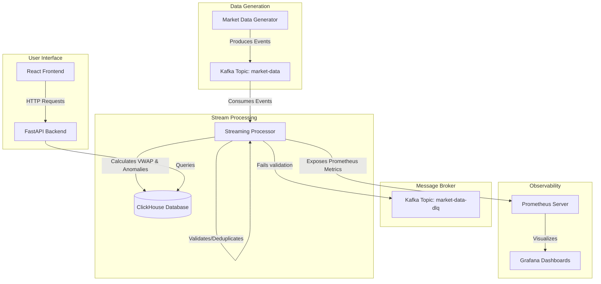

# Architectural Design

This document details the components, system responsibilities, and data flow of the Real-Time Market Data Platform.

## High-Level System Architecture

## Core Components

1. **Market Data Generator**:
   - Synthesizes trade events adhering to strict Pydantic data schemas.
   - Embeds fault injector mechanisms for late, duplicate, malformed, and anomalous prices.
2. **Streaming Processor**:
   - Consumes raw events from Kafka.
   - Performs event-time watermarking to drop late records.
   - Filters duplicate records using a local state window.
   - Calculates 5-second tumbling window aggregates (VWAP).
   - Evaluates price and volume Z-score anomalies.
3. **Database (ClickHouse)**:
   - Optimized columnar storage for fast aggregations, VWAP windows, and anomalies.
4. **Monitoring (Prometheus & Grafana)**:
   - Tracks metrics including throughput, latencies, validation failures, and anomalies.
5. **API & Frontend**:
   - FastAPI routes serve metrics and alerts to a React-based monitoring dashboard.