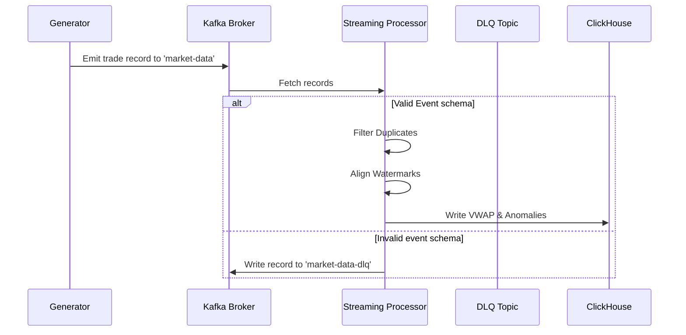

# Kafka Topics and Event Flow

This document outlines the Kafka topic architecture and schema flow.

## Topics

1. **`market-data`**:
   - **Purpose**: Unified incoming stream of raw transaction ticks.
   - **Partitions**: 3 (for load distribution)
   - **Replication**: 1 (local simulation) or 3 (production deployment)
   - **Retention**: 24 hours
2. **`market-data-dlq`**:
   - **Purpose**: Direct destination for transactions failing validation.
   - **Partitions**: 1
   - **Replication**: 1

## Event Flow Diagram

